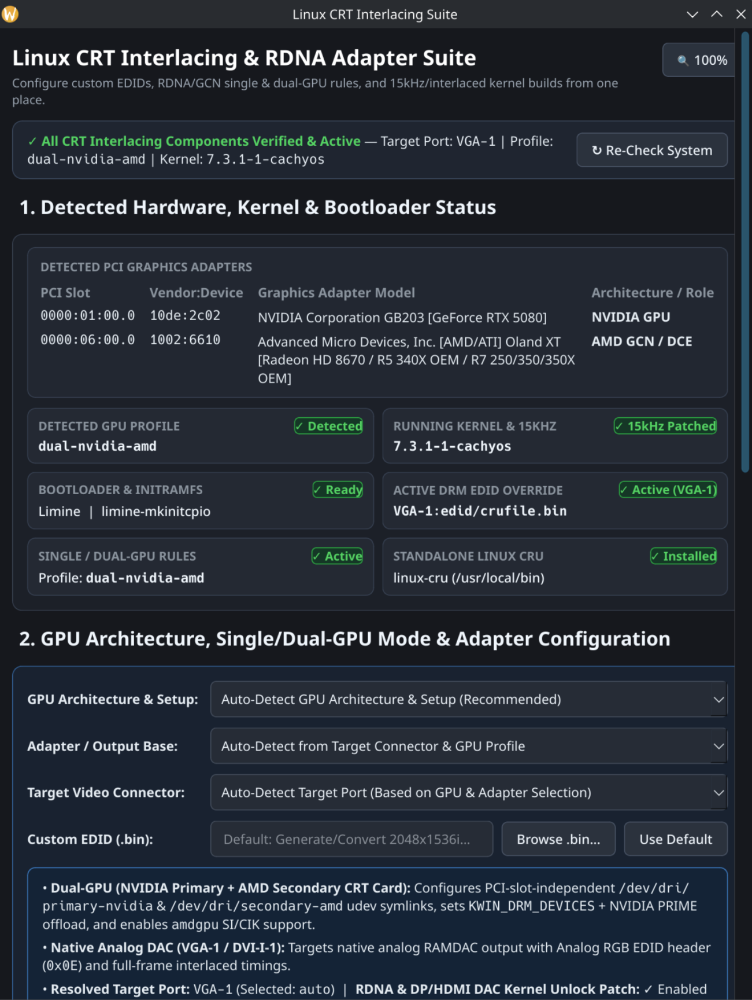
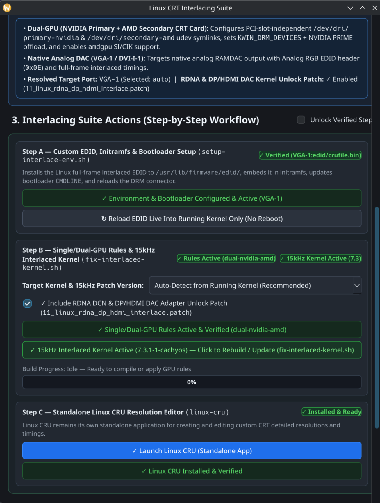
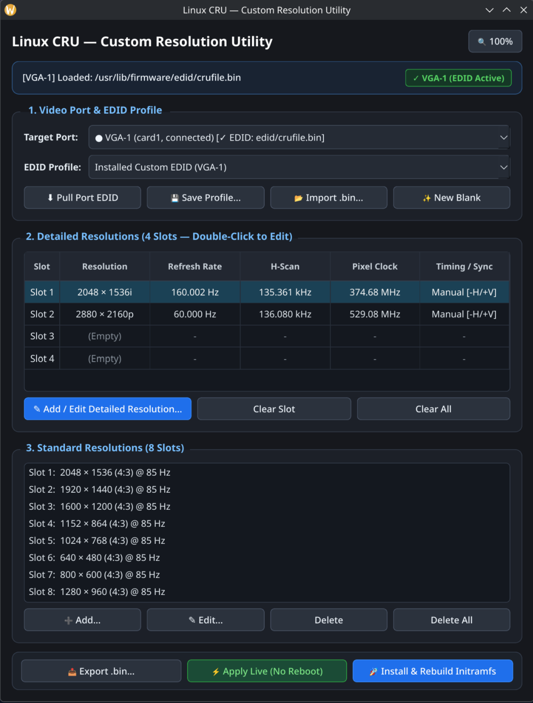

# Linux-interlacing-wayland-7.x.x

I used AI to automate the processes that I have been doing for EDID configurations and installing the 15kHz patches for monitor interlacing. I am not an experienced coder or scripter. **_USE THESE AT YOUR OWN RISK_**.

Tested on CachyOS, `7.3` kernels, KDE Plasma Wayland, and an HP p1230 (2070sb rebadge) CRT monitor.

---

## Getting Started (Download & Install)

### Option 1: Install the Native Arch / CachyOS Package (`.pkg.tar.zst`)
Clone the repository, enter the folder containing the `.pkg.tar.zst` package, and install it with `pacman`:

```bash
git clone https://github.com/Klay28a/Linux-interlacing-wayland-7.x.x.git
cd Linux-interlacing-wayland-7.x.x
sudo pacman -U linux-interlace-suite-1.0.0-1-any.pkg.tar.zst
```

### Option 2: Universal Script Installer (Arch / CachyOS, Debian / Ubuntu, Fedora, openSUSE)
```bash
git clone https://github.com/Klay28a/Linux-interlacing-wayland-7.x.x.git
cd Linux-interlacing-wayland-7.x.x
chmod +x *.sh *.py
./install.sh
```

---

## 1. Linux CRT Interlacing Suite (`linux-interlace-suite`)

**Linux CRT Interlacing Suite** (`linux-interlace-suite`) is a unified graphical manager for configuring custom CRT EDIDs, Single-GPU & Dual-GPU rules (AMD RDNA 1–4, AMD GCN, NVIDIA), DisplayPort/HDMI DAC adapters, and 15kHz/interlaced kernel builds from one place without needing the terminal.

- **Auto-Detection & Hardware Verification:** Detects your GPUs, active DRM connectors, bootloader (`Limine` / `GRUB`), initramfs tool, and 15kHz kernel status with live `✓` verification badges.
- **One-Click Workflow:** Configure your GPU profile (`Single-GPU` or `Dual-GPU`), adapter mode (`DP DAC`, `HDMI DAC`, or `Native Analog`), and target kernel (`7.3`, `7.2`, `6.18 LTS`, `6.12 LTS`, `6.6 LTS`, `6.1 LTS`, `linux-next`), then run EDID setup, live EDID reloads, or kernel builds with a live progress bar.

Launch **Linux Interlacing Suite** from your Application Menu / Desktop shortcut, or run:
```bash
linux-interlace-suite
```

<p align="center">
  
  &nbsp;&nbsp;
  
</p>

---

## 2. Linux CRU (`linux-cru` / `install-linux-cru.sh`)

**Linux CRU (`linux-cru`)** is a standalone Linux alternative to ToastyX's Custom Resolution Utility (CRU). It calculates exact ToastyX timings (`CVT Standard`, `CVT-RB`, `CVT-RB2`, `GTF Standard`, `Automatic CRT/PC/HDTV`, `Exact`, `Manual`) with `.5`-line interlaced precision, formats interlaced resolutions using Linux full-frame vertical lines, stores user profiles in `~/Documents/linux-cru/`, and can apply EDID changes live without rebooting or install them to your initramfs/bootloader.

**Install & Launch:**
```bash
cd Linux-interlacing-wayland-7.x.x
chmod +x install-linux-cru.sh
./install-linux-cru.sh
linux-cru
```

<p align="center">
  
</p>

---

## 3. Core Setup & Kernel Scripts (`setup-interlace-env.sh` & `fix-interlaced-kernel.sh`)

These scripts can be run automatically through the **Linux Interlacing Suite** GUI or directly from the terminal:

- **`setup-interlace-env.sh`**: Detects your target video connector (`VGA-*`, `DVI-I-*`, `DP-*`, `HDMI-A-*`), prepares a Linux full-frame interlaced EDID in `/usr/lib/firmware/edid/`, embeds it into your initramfs (`mkinitcpio`, `dracut`, or `initramfs-tools`), updates your `Limine` or `GRUB` kernel `CMDLINE`, and reloads the EDID live into the running kernel.
  - For manual `CMDLINE` setup details, see `u/raven2cz`'s comment on [r/archlinux](https://www.reddit.com/r/archlinux/comments/1lpjz3p/help_setting_custom_edid_for_monitor/). Example `Limine` config:
    ```ini
    KERNEL_CMDLINE[default]+="quiet nowatchdog splash rw rootflags=subvol=/@ root=UUID=17b88c21-6079-4146-af74-bde4fe7209fe radeon.si_support=0 amdgpu.si_support=1 radeon.cik_support=0 amdgpu.cik_support=1 drm.edid_firmware=VGA-1:edid/crufile.bin video=VGA-1:e"
    ```
- **`fix-interlaced-kernel.sh` (with `11_linux_rdna_dp_hdmi_interlace.patch`)**: Pulls the latest CachyOS kernel `PKGBUILD`, applies the 15kHz and interlace patches from [`D0023R/linux_kernel_15khz`](https://github.com/D0023R/linux_kernel_15khz) (`01`–`05`, `07`–`09`) plus `11_linux_rdna_dp_hdmi_interlace.patch` (unlocking RDNA 1–4 DCN interlacing and DP/HDMI DAC adapter clock/dongle limits), configures Single/Dual-GPU Wayland rules, and compiles/installs the patched kernel.


<br>

---
---

# Version Catalog, Changelog & Feature Comparison

## Application Version Catalog

| Application / Script | Current Version | Description |
| :--- | :--- | :--- |
| **Linux CRU (`install-linux-cru.sh` / `linux-cru`)** | **`v2.1.0`** | Standalone ToastyX-accurate Custom Resolution Utility for Linux with `.5`-line interlaced precision, instant preset-to-Manual handoff, `~/Documents/linux-cru` profile management, and responsive UI scaling |
| **Linux Interlacing Suite (`linux-interlace-suite.py`)** | **`v1.0.0`** | Unified PyQt6 GUI manager for configuring EDID overrides, Single/Dual-GPU RDNA/GCN/NVIDIA rules, DP/HDMI DAC adapters, and 15kHz/interlaced kernel builds |
| **Environment & EDID Setup (`setup-interlace-env.sh`)** | **`v2.0.0`** | Standalone & CLI/GUI-compatible custom EDID firmware, initramfs (`mkinitcpio`, `dracut`, `initramfs-tools`), bootloader (`Limine`, `GRUB`), and live DRM hotplug configurator |
| **15kHz & RDNA Interlace Kernel Patcher (`fix-interlaced-kernel.sh`)** | **`v2.0.0`** | CachyOS / Arch kernel builder with `D0023R/linux_kernel_15khz` patches (`01`–`05`, `07`–`09`) + `11_linux_rdna_dp_hdmi_interlace.patch` and multi-kernel selector (`7.3`, `7.2`, `6.18`, `6.12`, `6.6`, `6.1`, `linux-next`) |

---

## Recent Changes Log

- **Linux CRU `v2.1.0` (`install-linux-cru.sh`):**
  - Ported ToastyX CRU's exact `DetailedResolutionClass` two-pass timing calculation engine (`CVT Standard`, `CVT-RB Standard`, `CVT-RB2 Standard`, `GTF Standard`, `Automatic CRT/PC/HDTV`, `Native PC/HDTV`, `Exact`, `Exact CRT`, `Manual`).
  - Added `.5`-line vertical timing precision for interlaced modes and 3-decimal frequency precision (`Hz` / `kHz`).
  - Added one-click **`✎ Switch to Manual (Keep Values)`** button and ToastyX-style manual calculation anchors (`Back Porch` / `Blanking` / `Total` and `Refresh Rate` / `H-Scan Rate` / `Pixel Clock`).
  - Redesigned the **Standard Resolution** editor with side-by-side `Horizontal × Vertical` inputs, automatic vertical grey-out when an aspect ratio (`4:3`, `16:10`, `5:4`, `16:9`) is selected, unified font sizing, and full custom `Width × Height` support.
  - Added `AnchoredScrollArea` scroll-position memory across window resizes, `Ctrl + Scroll` UI zoom scaling, segmented `Target Port` dropdowns (connected vs. greyed-out disconnected ports), and `~/Documents/linux-cru` profile storage.
  - Fixed installer failure when `~/bin` is missing and added automatic Start Menu & Desktop launcher creation.
- **Linux Interlacing Suite `v1.0.0` & RDNA DP/HDMI DAC Patch (`11_linux_rdna_dp_hdmi_interlace.patch`):**
  - Added standalone GUI suite (`linux-interlace-suite.py`) with live hardware/kernel/EDID verification cells, Single-GPU vs. Dual-GPU profile selector, DP/HDMI DAC adapter mode selector, and kernel compilation progress tracking.
  - Added `11_linux_rdna_dp_hdmi_interlace.patch` to unlock DP/HDMI DAC dongle timing caps, low/high dotclock HDMI encoder limits, and DCN line-buffer `interleave_en` programming on AMD RDNA 1 / 2 / 3 / 4 GPUs.

---

## Linux CRU — Feature Comparison Table (Old Repo Version vs. New Version)

| Category | Old Repo Version (`v1.0.0`) | New Version (`v2.1.0`) |
| :--- | :--- | :--- |
| **Timing Engine** | Single-pass float approximations for `Automatic CRT/PC/HDTV`, `Native PC/HDTV`, `CVT Standard`, `CVT-RB`, `CVT-RB2`, `GTF Standard`, `Manual` | Ported **ToastyX CRU's exact `DetailedResolutionClass` engine**: two-pass pixel clock & refresh refinement (`MinTimeCVT = 550000000`, `MinTimeCVTRB = 460000000`, `MinTimeGTF = 550000000`, `CPrime = 30`, `MPrime = 300`, 0.25/0.01 MHz steps) plus `Exact` & `Exact CRT` and full ToastyX lookup tables |
| **Interlaced `.5` Line Precision** | Integer-only vertical spinboxes (`QSpinBox`), rounding away half-lines | **Preserves `.5` line reductions** (`NoWheelDoubleSpinBox` with `.5` step): in `CVT Standard`, `CVT-RB Standard`, and `GTF Standard`, interlaced `Vertical Back Porch` and `Vertical Blanking` / `Vertical Total` preserve their `.5` reduction alongside a live **ToastyX Per-Field** breakdown |
| **Decimal Frequency Precision** | Refresh rate limited to 2 decimals; no editable H-Scan field | **3-decimal precision** for `Refresh Rate (Hz)` and `H-Scan Rate (kHz)`, **2-decimal precision** for `Pixel Clock (MHz)`, plus live `Actual: XXX.XXX Hz / kHz / MHz` readouts |
| **Switch Preset → Manual** | No quick switch button; manual re-entry required | **`✎ Switch to Manual (Keep Values)`** button (and dropdown switch) immediately unlocks all Horizontal, Vertical (including `.5` values), Polarity, Refresh Rate, H-Scan, and Pixel Clock fields with the exact values calculated right before |
| **Manual Mode Anchors** | Fixed calculation order | Radio button anchors for **Timing** (`Back Porch`, `Blanking`, `Total`) and **Frequency** (`Refresh Rate`, `H-Scan Rate`, `Pixel Clock`) |
| **Standard Resolution Popup** | Misaligned `QFormLayout`, clipped dropdown text, no `Height` field | Compact non-scrolling `QGroupBox` grid with side-by-side **`Resolution (H × V)`** (`Width px × Height px`), auto-widening dropdown menus, unified font sizes, automatic vertical grey-out when an aspect ratio (`4:3`, `16:10`, `5:4`, `16:9`) is selected, and **Custom (Width × Height)** manual vertical unlocking |
| **Target Port Dropdown** | Flat list; disconnected ports looked identical to connected ports | Segmented into `── Connected Video Ports ──` (enabled) and `── Disconnected Video Ports ──` / `── Pre-Configure ──` (greyed out) |
| **Profile Folder** | Hidden in `~/.config/linux-cru/profiles` | Stored in **`~/Documents/linux-cru/`** (auto-migrates/discovers `.bin` files from `~/Documents` and `~/.config/linux-cru/profiles`) |
| **UI Scaling, Resize Reflow & Scroll Memory** | Fixed window; clipped text and spinboxes on smaller windows; scroll position reset on resize | `AnchoredScrollArea` viewports that **preserve your exact scroll position** when resizing windows taller and smaller again, `Ctrl + Scroll` / `Ctrl + +/-/0` UI zoom (`75%`–`165%`), and dynamic `resizeEvent` reflow |
| **Installer (`install-linux-cru.sh`)** | Failed when `~/bin` did not exist and exited before creating desktop shortcuts | Installs to `~/.local/bin/linux-cru` & `/usr/local/bin/linux-cru`, creates Start Menu & Desktop shortcuts, and skips redundant `pacman` prompts when `PyQt6` is already installed |

